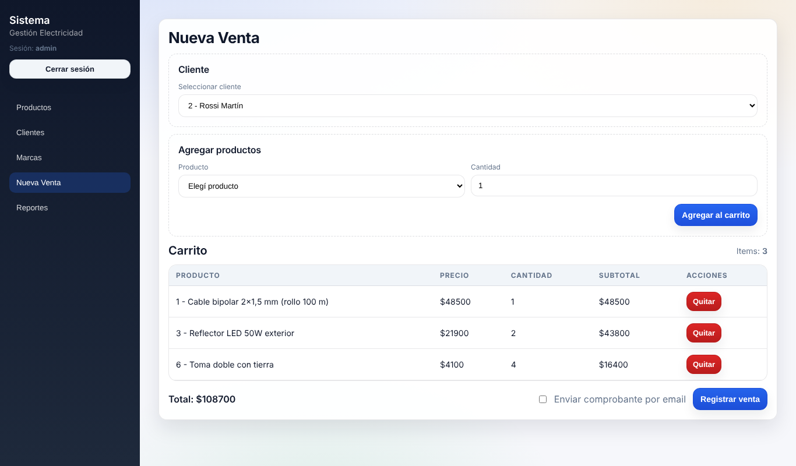
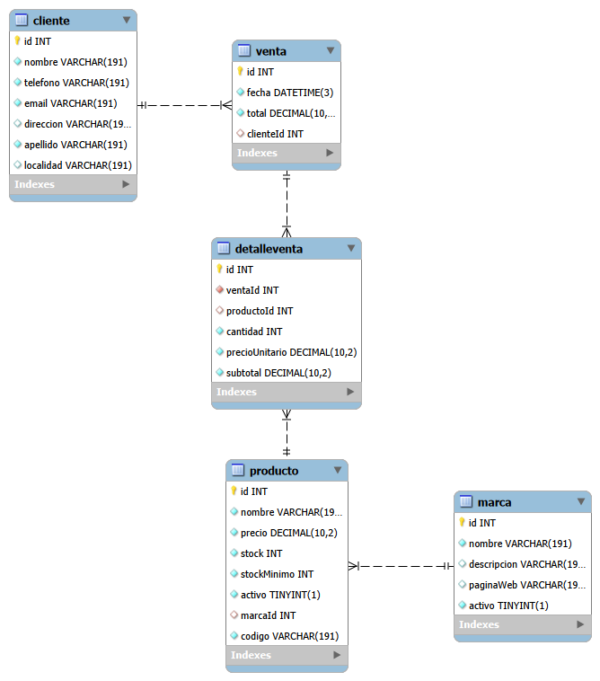
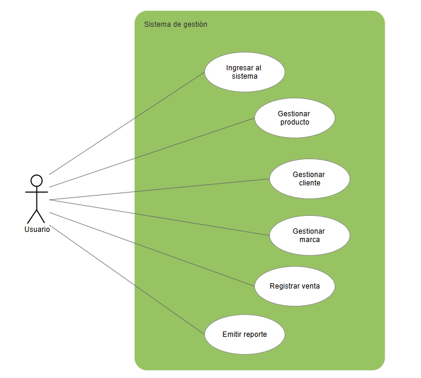
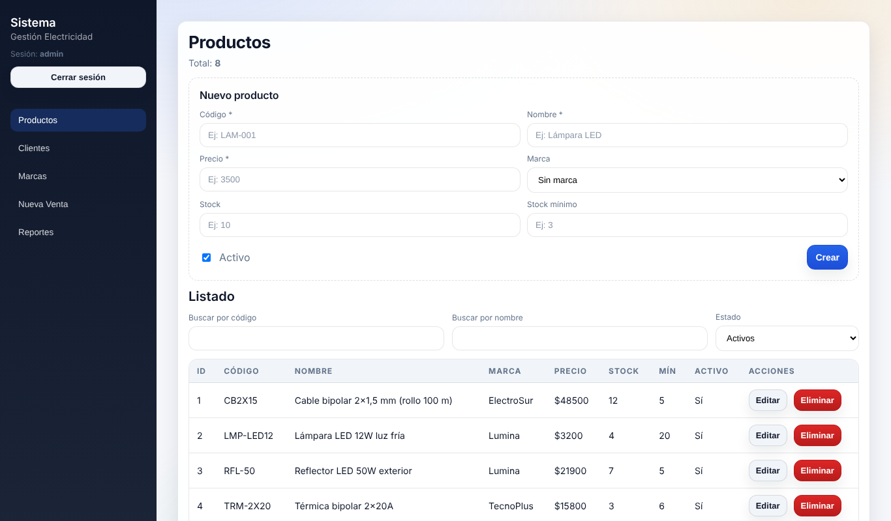
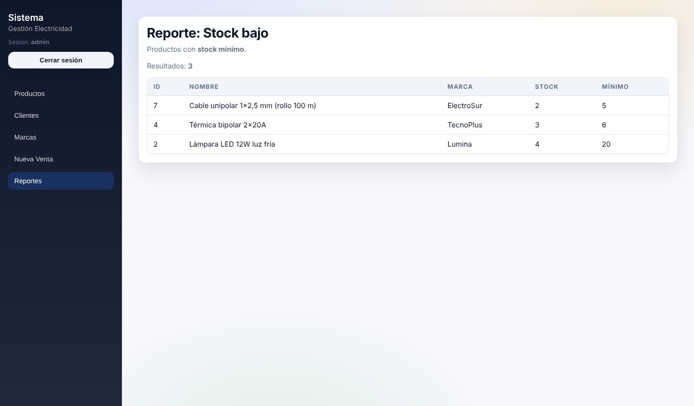
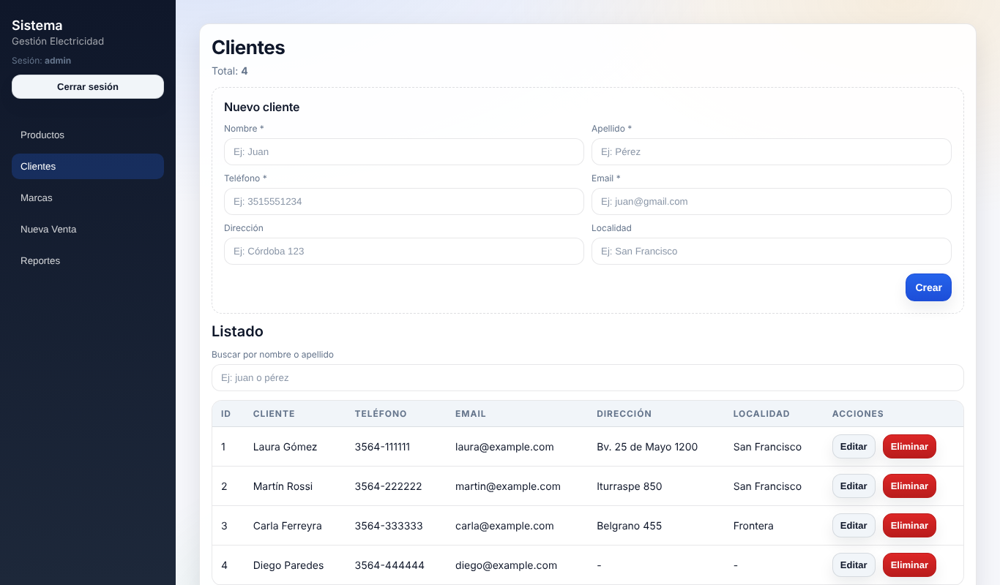
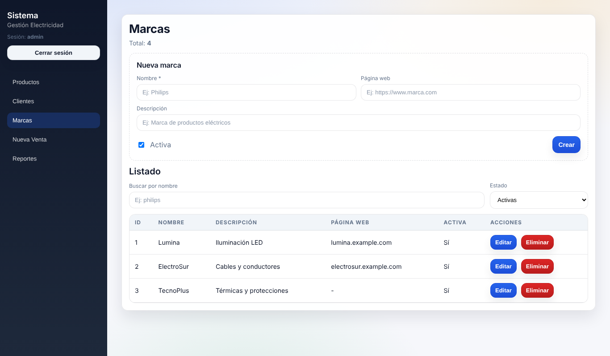

# Sistema de gestión web para un comercio de artículos eléctricos

Aplicación web full stack para gestionar productos, clientes, marcas y ventas de un comercio minorista, con control de stock y envío de comprobantes por email.

Desarrollado de forma individual como **Práctica Profesional Supervisada** de la Tecnicatura Universitaria en Programación (UTN Facultad Regional San Francisco, 2026). El objetivo fue reemplazar el sistema de escritorio que usaba el comercio por una aplicación web más simple, accesible y fácil de mantener.



## Funcionalidades

- **Login** con usuario y contraseña. Las rutas de la API están protegidas con **JWT**.
- **Productos:** alta, edición, baja y listado, con filtros por código, nombre y estado.
- **Clientes:** alta, edición, baja y búsqueda por nombre o apellido.
- **Marcas:** alta, edición, baja y filtros. Si se elimina una marca, sus productos quedan sin marca en lugar de borrarse.
- **Ventas:**
  - venta a consumidor final o a un cliente registrado;
  - carrito con varios productos y cálculo automático del total;
  - aviso si la cantidad supera el stock disponible;
  - descuento automático del stock al confirmar;
  - envío opcional del comprobante por email.
- **Reporte de stock bajo:** lista los productos activos con stock igual o menor al mínimo definido.

## Tecnologías

| Parte | Tecnologías |
|---|---|
| Frontend | React, React Router, JavaScript, HTML, CSS |
| Backend | Node.js, Express, API REST, JWT, Nodemailer |
| Base de datos | MySQL, Prisma ORM (modelado y migraciones) |
| Herramientas | Git, GitHub, Postman, Visual Studio Code |

## Arquitectura

Arquitectura cliente–servidor en tres partes:

1. **Frontend (React):** pantallas, navegación y validaciones básicas. Consume la API.
2. **Backend (Express):** expone la API REST y concentra la lógica de negocio: validaciones, cálculo de totales, control de stock y autenticación.
3. **Base de datos (MySQL + Prisma):** guarda productos, clientes, marcas, ventas y el detalle de cada venta.

La venta se registra dentro de una **transacción**. Se validan los productos y el stock, se crean la venta y su detalle, y se descuenta el stock. Si algo falla en el medio, no se guarda nada, así que nunca queda una venta a medias.

### Modelo de datos



### Casos de uso



## Capturas

Las capturas usan datos de prueba ficticios.

| Productos | Reporte de stock bajo |
|---|---|
|  |  |
| **Clientes** | **Marcas** |
|  |  |

## Endpoints de la API

Todas las rutas, salvo el login, requieren el header `Authorization: Bearer <token>`.

| Módulo | Método | Endpoint | Descripción |
|---|---|---|---|
| Auth | POST | `/api/auth/login` | Iniciar sesión |
| Productos | GET / POST | `/api/productos` | Listar / crear |
| Productos | GET / PUT / DELETE | `/api/productos/:id` | Ver / editar / eliminar |
| Clientes | GET / POST | `/api/clientes` | Listar / crear |
| Clientes | GET / PUT / DELETE | `/api/clientes/:id` | Ver / editar / eliminar |
| Marcas | GET / POST | `/api/marcas` | Listar / crear |
| Marcas | GET / PUT / DELETE | `/api/marcas/:id` | Ver / editar / eliminar |
| Ventas | GET / POST | `/api/ventas` | Listar / registrar venta |
| Ventas | GET | `/api/ventas/:id` | Ver venta con su detalle |
| Ventas | POST | `/api/ventas/:id/enviar-correo` | Enviar comprobante por email |
| Reportes | GET | `/api/reportes/stock-bajo` | Productos con stock bajo |

## Cómo correrlo en local

**Requisitos:** Node.js 18 o superior y MySQL.

### 1. Backend

```bash
cd backend
npm install
```

Copiar `backend/.env.example` como `backend/.env` y completar los datos de MySQL y una clave para `JWT_SECRET`. Después:

```bash
npx prisma migrate deploy
npm run dev
```

La API queda en `http://localhost:3001`.

### 2. Frontend

En otra terminal:

```bash
cd frontend
npm install
npm start
```

La aplicación queda en `http://localhost:3000`.

**Usuario de prueba:** `admin` / `admin`

## Pruebas

- **Backend:** cada endpoint se probó con Postman (altas, modificaciones, bajas y listados).
- **Sistema completo:** pruebas manuales documentadas del flujo completo:
  - login correcto e incorrecto;
  - acceso a rutas protegidas sin token;
  - validaciones de datos obligatorios;
  - carrito y cálculo de totales;
  - descuento de stock;
  - reporte de stock bajo.

## Próximas mejoras

- Usuarios guardados en la base de datos, con contraseñas encriptadas y roles (administrador y vendedor).
- Configurar la URL de la API por variable de entorno, para poder desplegarlo.
- Tests automatizados del backend.
- Historial de ventas y reportes de ventas por período.
